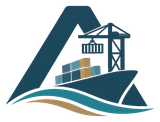

<p align="center">
  <picture>
    <source media="(prefers-color-scheme: dark)" srcset=".github/assets/logo-dark.png">
    
  </picture>
</p>

<p align="center"><b>Mobile App</b> &nbsp;|&nbsp; the plan, in the pocket of whoever carries it out</p>
<p align="center"><i>Smarter coordination. Stronger ports.</i></p>

<p align="center">
  
  
</p>

<p align="center">
  
  
  
  
  
  
</p>


## What lives here

The app for the people who actually move the ships: **pilots, tug masters and field supervisors**. They get their tasks on it and report what really happened, and those reports are what keep the plan, the tracking and the AI feedback loop honest.

A quay is not a friendly place for Wi-Fi, so the app is built to keep working when the signal disappears.

## What it does

- **Receives tasks** that come out of confirmed operational plans.
- **Reports actual status**, with real times and progress, which feed tracking, deviation logs and Part 3 of the AI.
- **Works offline.** Every action goes into a local outbox with an idempotency key and syncs through `/sync/events` once the phone is back online. Nothing is lost and nothing is counted twice.
- **Stays current.** A WebSocket event says something changed, then a REST call fetches the full payload. There is no FCM or APNs push service in the loop.
- **Stays inside the port.** Phones are managed devices (MDM) with a per-app, always-on VPN and split DNS on `app.atlantech.io`.

## Stack

| Area | Technology |
|---|---|
| Framework | Flutter, Dart `^3.11.5` |
| Platforms | Android, iOS |
| Talking to the server | REST over HTTPS, WebSocket (Laravel Reverb) |
| Sync | Local outbox with idempotent events |
| Network | Per-app VPN through the port's VPN gateway |
| Backend | [ATLANTECH Port API](https://github.com/Atlantech-project/project-backend) |

## Getting started

You'll need the Flutter SDK (Dart `^3.11.5`) and Android Studio or Xcode.

```bash
git clone https://github.com/Atlantech-project/project-mobile.git
cd project-mobile

flutter pub get
flutter run
```

Before you open a pull request:

```bash
flutter analyze
flutter test
```

## Neighbours

[PortHub](https://github.com/Atlantech-project/PortHub) &middot;
[project-backend](https://github.com/Atlantech-project/project-backend) &middot;
[project-ai](https://github.com/Atlantech-project/project-ai) &middot;
[project-frontend](https://github.com/Atlantech-project/project-frontend)

## Crew

**Farouk Ahmed Farouk El-Balkiny**, Mobile App Developer


<p align="center">
  <picture>
    <source media="(prefers-color-scheme: dark)" srcset=".github/assets/symbol-dark.png">
    
  </picture>
</p>

<p align="center">
  <sub>ATLANTECH, Intelligent Port Operations &middot; Mansoura University &middot; Graduation Project 2026</sub>
</p>
